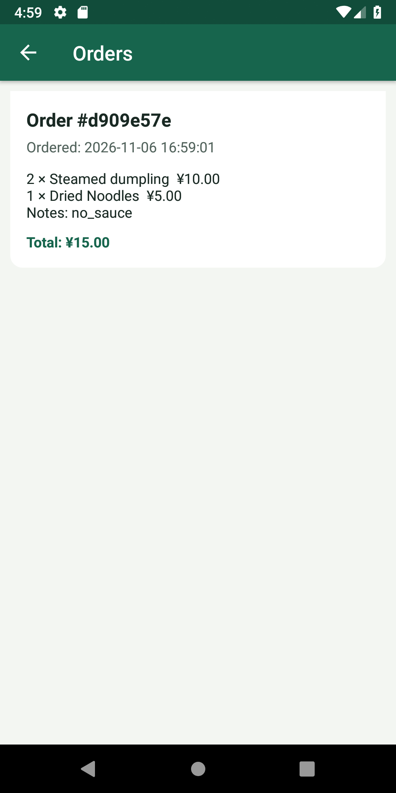

# Takeaway

English | [简体中文](README.zh-CN.md)

**Android food ordering app built with Java, Kotlin, XML layouts, SQLite and Gradle.**

Takeaway lets users browse regional dishes, adjust quantities from the menu or cart, and sign in to place an order. Order history shows the items, total and notes for each checkout.

| Home | Menu | Order history |
| --- | --- | --- |
|  |  |  |

## Features

- **Menu and cart.** Home and Menu share the same catalog, so a dish shows the same price from either entry point. Quantity changes in the menu carry over to the cart.
- **Checkout and order history.** Each checkout creates one order ID and saves all line items in a single SQLite transaction. The order card shows quantities, line totals, the order total and notes.
- **Local accounts.** Users can register, sign in and sign out. Delivery addresses and food preferences are saved per account.

The app runs locally and stores orders in SQLite on the device. Payment, refund and review entries display an availability message.

## Project delivery

Takeaway began as a team course project. I set up the Android app structure and developed and tested registration, sign-in, menu browsing, cart and checkout. I used Jira to break down the work, track progress and coordinate acceptance checks.

The delivery notes cover the Sprint 1 schedule and acceptance criteria, with a tested example from selecting dishes to viewing the saved order. [Project delivery notes in Chinese](docs/project-delivery.md)

## Run locally

1. Open the project root in Android Studio. Configure JDK 8 and install Android SDK Platform 30 and Build Tools 30.0.3.
2. Build the debug APK with the Gradle Wrapper. Run `.\gradlew.bat assembleDebug` on Windows or `sh ./gradlew assembleDebug` on macOS or Linux.
3. Run the `app` module on an emulator or Android device. Create a local test account from the Account tab.
4. Select two dishes in Menu, adjust their quantities and place the order from Cart. Open **Account → My orders** to see the saved order.

The project uses Gradle Wrapper 6.5. The ordering flow was verified on an Android 9 emulator (API 28).
