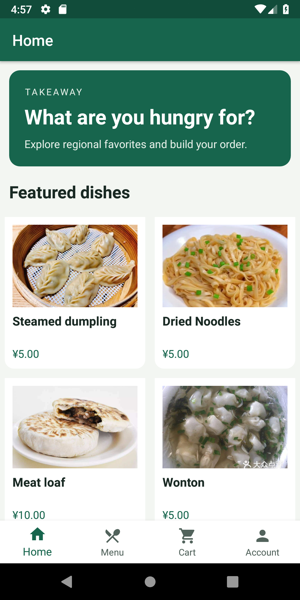
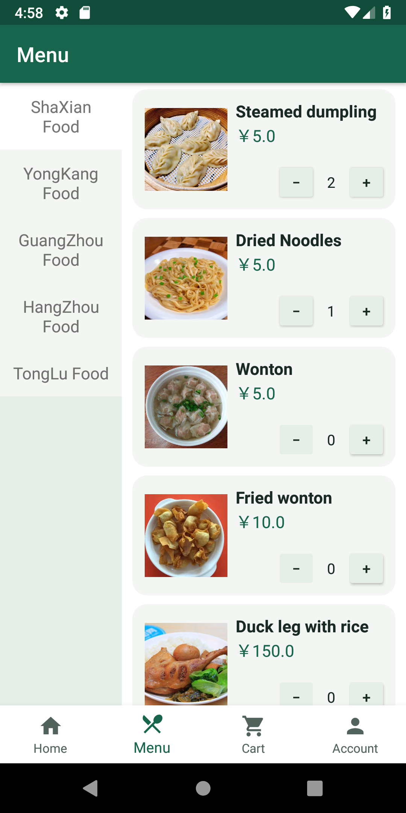

<div align="center">

<h1>Takeaway</h1>
<p><strong>Browse a dish. Build your cart. Keep the order.</strong></p>
<p>A local Android food ordering app with account-based preferences and saved order details.</p>

<p>


</p>

<p><a href="#a-look-inside">Screens</a> · <a href="#from-menu-to-order-history">Ordering</a> · <a href="#run-it-on-android">Build & run</a> · <a href="#project-background">Project background</a> · <a href="README.zh-CN.md">中文</a></p>

</div>

## A look inside

| Find a dish | Adjust your order | Revisit a checkout |
| --- | --- | --- |
|  |  |  |

Takeaway connects the everyday steps of placing a food order. Browse regional dishes, adjust quantities from the menu or cart, then sign in to save your checkout.

## From menu to order history

| 🍜 Explore | 🛒 Put an order together | 📋 Keep the details |
| --- | --- | --- |
| Home and Menu share one catalog and consistent prices. | Quantity changes carry into the cart. | Each checkout has its own order ID, items, quantities, total and notes. |

**Your account remembers your preferences.** Register and sign in locally, then save delivery details and food preferences for that account. You can sign out from the Account tab.

**A checkout stays together.** All line items are saved in one SQLite transaction. History groups them by order ID and adds their line totals. Older records without an order ID remain separate entries.

## Run it on Android

Open the repository root in Android Studio with the following tools installed.

| Tool | Version |
| --- | --- |
| JDK | 8 |
| Android SDK Platform | 30 |
| Android Build Tools | 30.0.3 |
| Gradle Wrapper | 6.5, included |

Build a debug APK on Windows.

```powershell
.\gradlew.bat assembleDebug
```

On macOS or Linux, use `sh ./gradlew assembleDebug`. Run the `app` module on an emulator or Android device.

**Try the complete flow**

1. Create a local test account from **Account**.
2. Select two dishes in **Menu** and adjust their quantities.
3. Place the order from **Cart**.
4. Open **Account → My orders** and inspect the saved items and total.

This flow was verified on an Android 9 emulator, API 28.

<details>
<summary><strong>Inside the project</strong></summary>

The app uses Java, a small amount of Kotlin, XML layouts and SQLite. Delivery details and food preferences use account-specific SharedPreferences.

| Directory | Contents |
| --- | --- |
| `app/src/main/java/com/example/order/activity/` | Screens and account entry points |
| `app/src/main/java/com/example/order/ui/` | Home, menu, cart and account tabs |
| `app/src/main/java/com/example/order/dao/` | Accounts and order storage |
| `app/src/main/java/com/example/order/data/` | Shared dish catalog |
| `app/src/main/res/` | Layouts, icons and dish images |
| `docs/images/` | Interface screenshots |

</details>

## Project background

Takeaway began as a team course project. I set up the Android app structure and developed and tested registration, sign-in, menu browsing, cart and checkout. I used Jira to break down the work, track progress and coordinate acceptance checks.

The delivery notes include the Sprint 1 schedule, acceptance criteria and a tested ordering example. [Project delivery notes in Chinese](docs/project-delivery.md)

## What's included today

The ordering flow runs locally, with orders stored in SQLite on the device. Payment, refund, review and payment-settings entries show an availability message. Restaurant service integration, payment processing and delivery arrangements remain future work.
