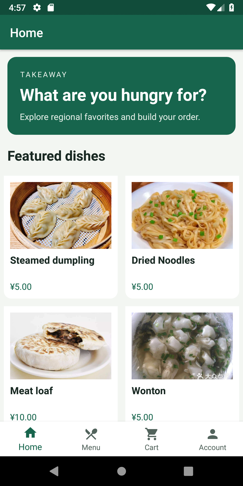
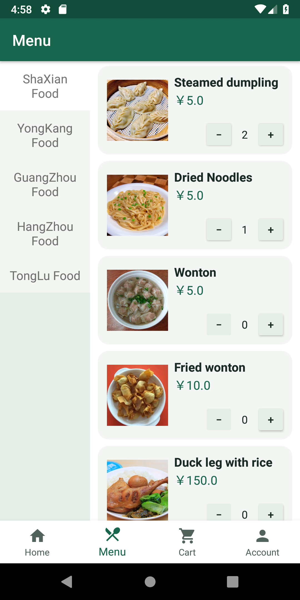
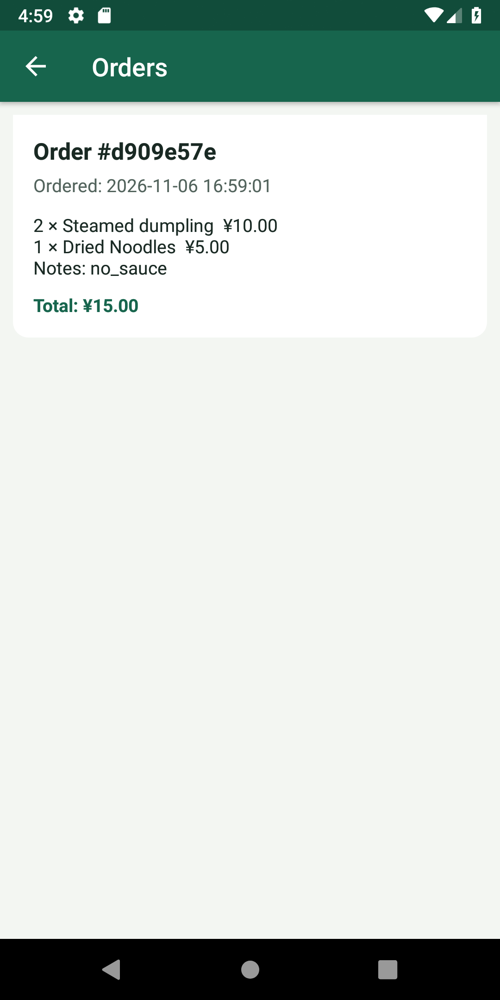

# Takeaway
**Android 点餐应用 · Java 为主，少量 Kotlin · XML 布局 · SQLite · Gradle**

Takeaway 是一款 Android 点餐应用。用户可以浏览地方菜品，在菜单或购物车里调整数量，登录后提交订单，并查看包含菜品明细和备注的历史订单。

| 首页 | 菜单 | 订单详情 |
| --- | --- | --- |
|  |  |  |

## 功能

- **菜单与购物车**。首页和菜单共用菜品数据。两个页面进入同一道菜时，显示相同价格。在菜单加减数量后，购物车随之更新。
- **结算与订单历史**。一次提交生成一个订单编号，所有菜品明细在同一数据库事务中保存。订单卡展示数量、小计、总价和备注。
- **本地账户**。支持注册、登录和退出。配送地址与口味设置按账号保存。

这是一个可在模拟器上运行的本地点餐应用，订单保存在设备的 SQLite 数据库中。支付、退款和评价入口目前会提示功能暂未开放。

## 项目管理与交付

项目从团队课程开发起步。我搭建 Android 应用框架，开发和调试注册登录、菜单、购物车及结算流程，同时用 Jira 拆解任务、跟进进度并协调验收。

项目交付说明列出了 Sprint 1 的任务安排与验收条件，并展示从菜单选菜到查看订单的实测示例。[项目交付说明](docs/project-delivery.md)

## 本地运行

1. 在 Android Studio 中打开项目根目录。配置 JDK 8，并安装 Android SDK Platform 30 和 Build Tools 30.0.3。
2. 通过 Gradle Wrapper 构建 Debug APK。在 Windows 中运行 `.\gradlew.bat assembleDebug`，在 macOS 或 Linux 中运行 `sh ./gradlew assembleDebug`。
3. 选择模拟器或 Android 设备运行 `app`。第一次使用时，可以在 Account 页新建本地测试账号。
4. 在 Menu 选择两种菜品并调整数量，从 Cart 提交，再到 Account 的 My orders 查看订单。

Gradle Wrapper 版本为 6.5。改版后的点餐流程已在 Android 9（API 28）模拟器上验证。
