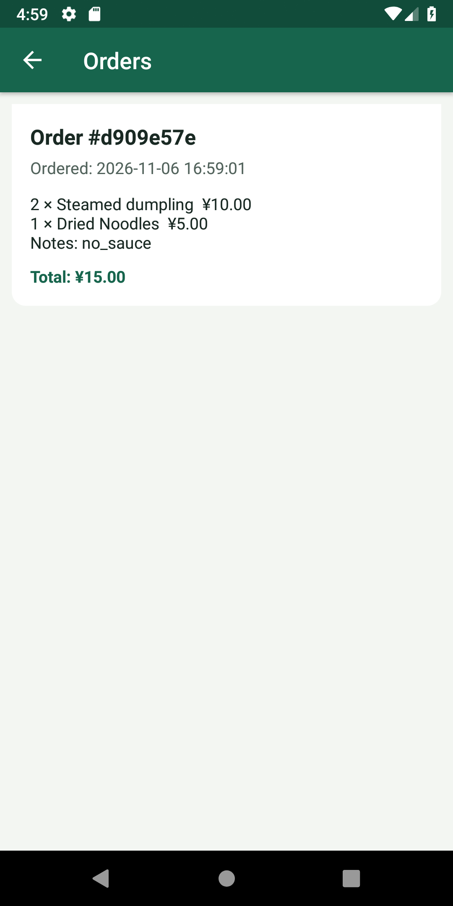

# Takeaway 项目交付说明

Sprint 1 的交付目标是跑通 Android 点餐流程。用户能浏览菜单、调整购物车、登录并提交订单，随后在订单历史中核对明细。

## 我的职责

我负责搭建 Android 应用框架，开发和调试注册登录、菜单浏览、购物车和订单结算。团队协作方面，我使用 Jira 拆解需求和跟进进度，协调开发、调试、验收与交付。

## Sprint 1 任务安排

**交付周期为 2023 年 3 月 24 日至 5 月 2 日。** 本阶段交付一套可在 Android 设备上演示的点餐应用，覆盖账户、菜单、购物车、结算和订单查询。各阶段以可检查的交付物衔接，最后通过完整点餐流程验收。

| 日期 | 阶段 | 任务与交付物 |
| --- | --- | --- |
| 3 月 24–30 日 | 需求与范围 | 明确浏览菜品、加入购物车、登录、提交订单和查询订单的用户流程。产出核心需求清单和演示范围 |
| 3 月 31 日–4 月 9 日 | 页面与数据设计 | 确定 Home、Menu、Cart、Account 四个入口，梳理菜品、购物车和订单之间的数据关系。产出页面导航方案和本地数据结构 |
| 4 月 10–16 日 | 框架搭建与任务拆解 | 搭建 Android 项目和页面导航，将账户、菜单、购物车、订单列表及设备测试拆成 Jira 任务，明确分工和联调顺序 |
| 4 月 17–23 日 | 核心功能开发 | 完成注册登录、菜品浏览和购物车。首页与菜单共用菜品数据，菜单加减数量后，购物车明细和合计同步更新 |
| 4 月 24–29 日 | 结算与订单联调 | 接通订单提交和历史查询。一次下单保存同一编号下的菜品明细和备注，整笔保存成功后清空购物车 |
| 4 月 30 日–5 月 2 日 | 验收与交付 | 构建 APK，检查选菜、数量、金额、订单分组和重启后的记录，整理报告、海报和演示材料 |

进度跟踪围绕两个联调节点展开。先确认菜单和购物车对同一道菜使用相同的价格与数量，再确认结算写入的订单能在历史页按编号完整展示。跨页面的问题回到对应 Jira 任务跟进，整条流程走通后再整理交付材料。

Sprint 范围包括本地下单和订单查询。支付、退款和评价保留为后续功能。

### Sprint 1 交付验收

下面是上述验收条件在当前版本中的实测示例。选两份蒸饺和一份拌面，确认这三份菜都归入同一笔订单。

| 操作 | 验收结果 |
| --- | --- |
| 在 Menu 加两份蒸饺和一份拌面，进入 Cart | 两种菜品的数量正确，合计 ¥15.00 |
| 填写备注后提交 | 提交成功后购物车清空 |
| 打开 My orders | 一张订单卡显示两种菜品、数量、小计、合计和备注 |
| 关闭应用并重新打开 My orders | 同一订单及备注仍可查看 |

验收记录和截图使用 Android 9 模拟器。
